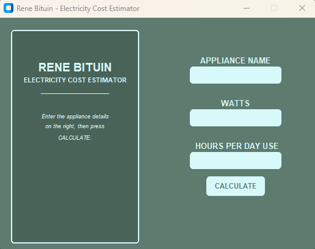

# Rene Bituin – Electricity Cost Estimator

[](https://www.python.org/)
[](https://customtkinter.tomschimansky.com/)
[](https://opensource.org/licenses/MIT)

**Rene Bituin – Electricity Cost Estimator** is a simple desktop application that estimates an appliance's electricity consumption and cost based on its power rating and daily usage. It uses a configured electricity rate of **PHP 12.31 per kWh** for Cagayan de Oro (CDO).

> **Note:** The rate is hardcoded as an estimate. Actual electricity rates and bills may vary depending on the provider, billing period, taxes, fees, and other charges.



---

## ✨ Features

| Feature | Description |
|---|---|
| **Desktop GUI** | A desktop interface built with CustomTkinter. |
| **Custom Appliance Input** | Enter the name of any appliance instead of choosing from a fixed list. |
| **Power Rating Input** | Enter the appliance's power rating in watts. |
| **Daily Usage Input** | Enter how many hours per day the appliance is used. |
| **Energy Estimation** | Calculates estimated daily and monthly energy consumption in kWh. |
| **Cost Estimation** | Estimates daily and monthly electricity costs using the configured CDO rate. |
| **Input Validation** | Checks required fields, numeric values, positive wattage, and usage between 0 and 24 hours. |
| **Results Panel** | Displays appliance details, energy estimates, and cost estimates in the application window. |

---

## 🚀 Quick Start

### Prerequisites

- **Python 3.8 or higher**
- Windows, macOS, or Linux with a graphical desktop environment

### Installation

1. Clone the repository:

   ```bash
   git clone https://github.com/yourusername/rene-bituin-cost-estimator.git
   cd rene-bituin-cost-estimator
   ```

   Replace the example URL and folder name with your actual GitHub repository details.

2. (Recommended) Create a virtual environment:

   ```bash
   python -m venv venv
   ```

3. Activate the environment.

   **Windows:**
   ```bash
   venv\Scripts\activate
   ```

   **macOS/Linux:**
   ```bash
   source venv/bin/activate
   ```

4. Install the packages used by the application:

   ```bash
   pip install customtkinter Pillow
   ```

5. Run the application. Replace `main.py` with your Python filename if it is different:

   ```bash
   python main.py
   ```

---

## 🧮 How the Estimate Works

The application uses the following calculations:

1. **Convert watts to kilowatts**

   ```text
   kilowatts = watts / 1000
   ```

2. **Calculate daily energy consumption**

   ```text
   daily_kWh = kilowatts × hours_per_day
   ```

3. **Estimate daily electricity cost**

   ```text
   daily_cost = daily_kWh × rate_per_kWh
   ```

4. **Estimate monthly energy consumption**

   ```text
   monthly_kWh = daily_kWh × 30
   ```

5. **Estimate monthly electricity cost**

   ```text
   monthly_cost = daily_cost × 30
   ```

The program assumes the appliance is used for the entered number of hours each day for a **30-day month**. Results are displayed to two decimal places.

---

## 🖥️ Usage

1. Launch the application.
2. Enter an appliance name, such as `Electric Fan`.
3. Enter its power rating in watts, such as `60`.
4. Enter the number of hours it is used per day, such as `8`.
5. Click **CALCULATE** or press **Enter** while in an input field.
6. Read the estimated daily and monthly energy consumption and electricity costs in the results panel.

### Example

For an appliance rated at **60 watts**, used **8 hours per day**, with the configured rate of **PHP 12.31/kWh**:

| Result | Estimate |
|---|---:|
| Daily energy consumption | 0.48 kWh |
| Monthly energy consumption (30 days) | 14.40 kWh |
| Daily electricity cost | PHP 5.91 |
| Monthly electricity cost (30 days) | PHP 177.26 |

These values are estimates, not a replacement for an actual electricity bill.

---

## 📦 Dependencies

| Package | Purpose |
|---|---|
| [CustomTkinter](https://customtkinter.tomschimansky.com/) | Provides the desktop UI components. |
| [Pillow](https://python-pillow.org/) | Image-processing library imported by the current code. |
| `tkinter` | Provides the text widget and message boxes; commonly included with standard Python installations. |

The current code imports `PIL.Image`, but does not use it in the shown interface. If you remove that import and do not use Pillow elsewhere, Pillow may not be needed.

---

## 🛠️ Project Structure

A suggested repository structure:

```text
rene-bituin-cost-estimator/
├── main.py          # Application code (use your actual filename)
├── README.md        # Project documentation
├── Screenshot.png   # Application screenshot
└── LICENSE          # Optional license file
```

Keep the screenshot filename and capitalization consistent with the image file committed to your repository.

---

## ⚠️ Limitations and Disclaimer

- The rate `12.31` is fixed in the source code; the application does not fetch live electricity rates.
- The monthly estimate assumes **30 days** of consistent daily usage.
- The estimate is based on the entered wattage and daily usage.
- Actual consumption and bills may differ due to changing rates, appliance behavior, other household appliances, taxes, and additional charges.
- This tool is intended for estimation and educational purposes only.

---

## 📝 License

If this project uses the MIT License, include a `LICENSE` file containing the MIT License text. Otherwise, update this section to match the license you choose.

---

<p align="center">
  Made with Python by <a href="https://github.com/aljunpagasian07-a11y">Aljun Pagasi-an</a>
</p>
